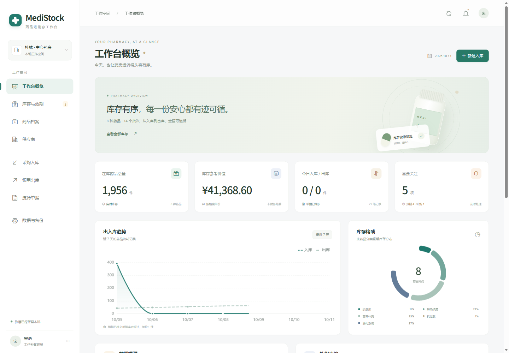

# MediStock · 药品进销存工作台

MediStock：Vue 药品进销存工作台，SQLite 批次库存、FEFO 出库、事务与幂等、供应商管理、单据追溯与统计图表。

作者：宋浩 · 桂林电子科技大学 · 计算机科学与技术 · 2027 届。

[个人作品集](https://shjhijoaj.github.io/hao-song-portfolio/) · [项目详情](https://shjhijoaj.github.io/hao-song-portfolio/projects/medistock.html) · [下载运行包](https://github.com/shjhijoaj/medistock/releases/tag/v2.0.1)

## 功能

- **批次与效期**：管理药品、供应商、批号和效期，识别临期、过期与低库存；拒绝冲突批次元数据。
- **单据与追溯**：采购入库、跨批次出库预览与提交，单据可展开批次明细；有关联业务的档案禁止直接删除。
- **统计与备份**：库存趋势、分类和效期提醒读取当前数据。支持 CSV 导出和经过关联、账本校验的 JSON 备份恢复。

## 本人职责

负责业务页面、药品和供应商档案、批次数据、出入库接口、统计图表、单据追溯及备份恢复，完成前后端联调和业务验证。

## 快速开始

### 便携包

Windows x64：解压后运行 启动药房工作台.cmd，访问 http://127.0.0.1:4313/。运行包随附 Node.js 24 与已构建前端，首次启动自动初始化示例数据库。

### 从源码运行

需要 Node.js 24+。执行 `npm ci`、`npm run build`、`npm start`，访问 http://127.0.0.1:4313/。`npm test` 执行库存规则测试。开发时先运行服务端，再运行 `npm run dev`。

## 实现

服务端按效期执行 FEFO（先到期先出库），以 SQLite 事务统一更新库存与单据，使用唯一请求标识识别重试。图表由实际演示库记录计算。

数据链路：Vue 业务工作台 → Node.js 接口 → FEFO 分配 → 库存 / 单据事务 → SQLite。

## 验证

8 项库存规则测试及 HTTP 集成验收通过，覆盖 FEFO、超库存回滚、幂等重试、备份与真实单据流程。

## 组件与许可

项目自有源码保留作者著作权，第三方库遵循各自许可证。依赖及参考说明见 [THIRD_PARTY_NOTICES.md](THIRD_PARTY_NOTICES.md)。
